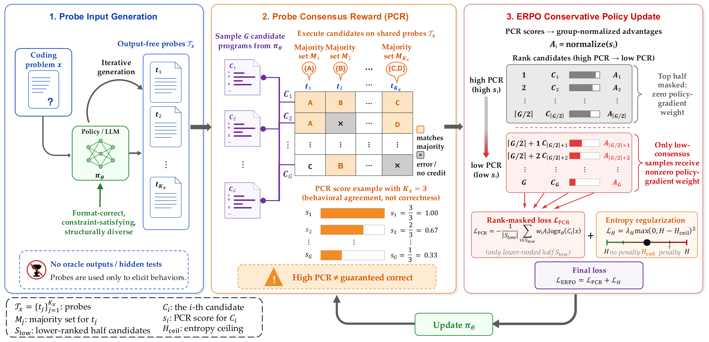

# ERPO: Entropy-Regularized Rank-Masked Policy Optimization for Test-Time Reinforcement Learning in Code Generation

[](https://2026.emnlp.org/)
[](https://arxiv.org/abs/2609.09135)
[](https://xiaobanni.github.io/projects/erpo/)

Official repository for the EMNLP 2026 paper **"Entropy-Regularized Rank-Masked Policy Optimization for Test-Time Reinforcement Learning in Code Generation"**, accepted as an **Oral** presentation (~2.6% of submissions).

*Jiacheng Xu, Feng Chen, Xiuneng Xu, Bo An*



## Installation

```bash
conda create -n erpo python=3.12
conda activate erpo
pip install -e ".[vllm]"
pip install flash-attn --no-build-isolation
```

The scripts assume one node with 8 GPUs (set `N_GPUS` to change it) and run from the repository root.

## Data

```bash
bash recipe/code_bench/scripts/prepare_data.sh
```

This prepares LiveCodeBench v6, CodeContests, CodeForces and TACO under `eval/<benchmark>/shared/`.

## Probe Generation

```bash
bash recipe/code_bench/scripts/generate_probes.sh
```

This generates 10 probe inputs per LiveCodeBench problem and writes them to `eval/livecodebench_v6/probes/lcb_probes_K10.parquet`.

## Training

```bash
export PROBE_PARQUET=eval/livecodebench_v6/probes/lcb_probes_K10.parquet
bash recipe/code_bench/scripts/train.sh erpo        # ERPO
bash recipe/code_bench/scripts/train.sh nsr_pcr     # NSR_PCR
bash recipe/code_bench/scripts/train.sh grpo_pcr    # GRPO_PCR
bash recipe/code_bench/scripts/train.sh grpo_pub    # GRPO_Pub (public-test reward, no probes)
```

Each run trains Qwen3-4B on LiveCodeBench for 150 steps and saves checkpoints under `checkpoints/qwen3_4b_lcb_<method>/`.

## Evaluation

**LiveCodeBench.** pass@1 / pass@16 are logged during training as `val-core/livecodebench_v6/full_pass@1` and `full_pass@16`. For the base model:

```bash
VAL_BEFORE_TRAIN=true bash recipe/code_bench/scripts/train.sh grpo_pub trainer.val_only=True
```

**CodeContests / CodeForces / TACO.**

```bash
bash recipe/code_bench/scripts/eval_transfer.sh <model_path> <output_dir>
```

## Citation

```bibtex
@inproceedings{xu2026erpo,
  title     = {Entropy-Regularized Rank-Masked Policy Optimization for Test-Time Reinforcement Learning in Code Generation},
  author    = {Jiacheng Xu and Feng Chen and Xiuneng Xu and Bo An},
  booktitle = {Proceedings of the 2026 Conference on Empirical Methods in Natural Language Processing},
  year      = {2026}
}
```

## Acknowledgements

Our RL training is built on [verl](https://github.com/volcengine/verl). We evaluate on [LiveCodeBench](https://livecodebench.github.io/), [CodeContests](https://arxiv.org/abs/2203.07814), CodeForces (both via the [CURE](https://github.com/Gen-Verse/CURE) releases) and [TACO](https://arxiv.org/abs/2312.14852).

## License

Apache License 2.0. `recipe/code_bench/testing_util.py` is adapted from [LiveCodeBench](https://github.com/LiveCodeBench/LiveCodeBench) under the MIT License.

## Contact

Questions and issues are welcome — open a GitHub issue or contact `jiacheng005@e.ntu.edu.sg`.
